<picture>
  <source media="(prefers-color-scheme: dark)" srcset="./assets/hero-dark.svg" />
  
</picture>

 

<picture>
  <source media="(prefers-color-scheme: dark)" srcset="https://readme-typing-svg.demolab.com?font=Fira+Code&weight=500&size=20&pause=1200&center=true&vCenter=true&width=720&lines=Building+scalable+full-stack+apps;Solving+algorithmic+problems+in+C%2B%2B;Exploring+the+open-source+ecosystem;Learning+everyday+%3A%29&color=9CCBFA" />
  
</picture>

 

<picture>
  <source media="(prefers-color-scheme: dark)" srcset="./assets/section-01-dark.svg" />
  
</picture>

I'm **Prashant**, a 3rd-year Computer Science engineering undergraduate. I love building scalable full-stack applications, solving complex algorithmic problems, and exploring the open-source ecosystem.

Most of what I build ships on **Next.js + TypeScript**, and I sharpen problem-solving in **C++** on LeetCode and Codeforces. Currently *focusing* — and learning every day.

 

<picture>
  <source media="(prefers-color-scheme: dark)" srcset="./assets/section-02-dark.svg" />
  
</picture>

<picture>
  <source media="(prefers-color-scheme: dark)" srcset="./assets/skills-dark.svg" />
  
</picture>

 

<picture>
  <source media="(prefers-color-scheme: dark)" srcset="./assets/section-03-dark.svg" />
  
</picture>

<table>
  <tr>
    <td width="50%" align="center">

<picture>
  <source media="(prefers-color-scheme: dark)" srcset="https://github-readme-stats-zeta-sepia-19.vercel.app/api?username=devprashant19&show_icons=true&include_all_commits=true&count_private=true&bg_color=0A1729&title_color=9CCBFA&text_color=C9DDF2&icon_color=4EA3F5&border_color=1C3656&border_radius=16" />
  
</picture>

</td>
    <td width="50%" align="center">

<picture>
  <source media="(prefers-color-scheme: dark)" srcset="https://github-readme-stats-zeta-sepia-19.vercel.app/api/top-langs/?username=devprashant19&layout=compact&bg_color=0A1729&title_color=9CCBFA&text_color=C9DDF2&border_color=1C3656&border_radius=16" />
  
</picture>

</td>
  </tr>
</table>

<picture>
  <source media="(prefers-color-scheme: dark)" srcset="https://github-readme-streak-stats-eight.vercel.app/?user=devprashant19&background=0A1729&border=1C3656&stroke=1C3656&ring=4EA3F5&fire=7DB8F2&currStreakNum=EAF4FF&sideNums=EAF4FF&currStreakLabel=9CCBFA&sideLabels=8AA8C8&dates=8AA8C8&border_radius=16" />
  
</picture>

 

<picture>
  <source media="(prefers-color-scheme: dark)" srcset="./assets/section-04-dark.svg" />
  
</picture>

<a href="https://prashant-bahuguna.vercel.app"><picture>
  <source media="(prefers-color-scheme: dark)" srcset="./assets/btn-portfolio-dark.svg" />
  
</picture></a>
<a href="https://linkedin.com/in/prashant-bahuguna19"><picture>
  <source media="(prefers-color-scheme: dark)" srcset="./assets/btn-linkedin-dark.svg" />
  
</picture></a>
<a href="mailto:dev.prashant1901@gmail.com"><picture>
  <source media="(prefers-color-scheme: dark)" srcset="./assets/btn-email-dark.svg" />
  
</picture></a>
<a href="https://leetcode.com/u/dev_prashantt"><picture>
  <source media="(prefers-color-scheme: dark)" srcset="./assets/btn-leetcode-dark.svg" />
  
</picture></a>
<a href="https://codeforces.com/profile/prashant_1901"><picture>
  <source media="(prefers-color-scheme: dark)" srcset="./assets/btn-codeforces-dark.svg" />
  
</picture></a>
<a href="https://x.com/_prashant__19"><picture>
  <source media="(prefers-color-scheme: dark)" srcset="./assets/btn-x-dark.svg" />
  
</picture></a>
<a href="https://instagram.com/_prashant__19"><picture>
  <source media="(prefers-color-scheme: dark)" srcset="./assets/btn-instagram-dark.svg" />
  
</picture></a>

  

<picture>
  <source media="(prefers-color-scheme: dark)" srcset="./assets/footer-dark.svg" />
  
</picture>

